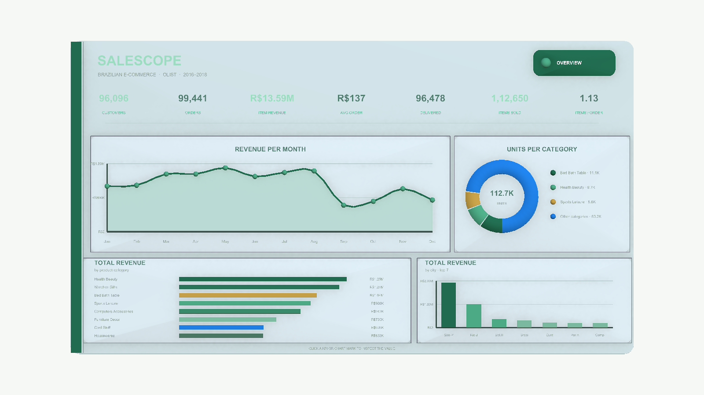

# Unity Olist Sales Dashboard

An editable 3D sales dashboard built with Unity 6.6. It uses extruded 3D scene geometry for its KPI marks, chart bars, axes, donut segments, labels, and chart panels. The scene is saved in Edit Mode so the objects are available in the Hierarchy.

## Open the project

1. Open this folder in Unity 6.6.7f1.
2. Open `Assets/Scenes/QuakeScopeDashboard.unity`.
3. Open `LiveData/OlistSales.csv` in Excel, append rows using the existing columns, and save it as CSV UTF-8.
4. Press Play. Unity reads the CSV directly in C#, recalculates the dashboard, and checks for saved changes every 1.5 seconds.

To rebuild the saved scene from the prepared dataset, use **Tools → QuakeScope → Build Editable 3D Dashboard**. The Edit Mode values and numeric axis labels are placeholders; Play Mode populates them from the CSV.

## Dashboard contents

- KPI row: unique customers, orders, item revenue, average order revenue, delivered orders, items sold, and items per order.
- Revenue by month, units by category, revenue by product category, and revenue by city.
- Clickable KPIs and chart bars show the selected value in the scene.
- KPI values, monthly line points, category donut segments, product bars, city columns, and numeric axis scales are recalculated from the live CSV.
- Chart colors use a ranked green palette: higher values use darker greens and lower values fade to lighter greens.

Revenue is based on item prices and excludes freight. The Olist tables do not contain profit, so the dashboard does not report profit.

## Data

This project uses the [Brazilian E-Commerce Public Dataset by Olist on Kaggle](https://www.kaggle.com/datasets/olistbr/brazilian-ecommerce). The downloaded compressed source tables are in `Datasets/OlistRaw/`. `LiveData/OlistSales.csv` is the Excel-editable order-line file read by Unity.

Append rows with the same columns as the header: `Order ID`, `Order Date`, `Ship Date`, `Customer ID`, `Region`, `Category`, `Sales`, `Quantity`, `City`, `Sub-Category`, and `Order Status`. Keep dates parseable (ISO dates are recommended), and enter `Sales` as a number using a decimal point. Save the file; Unity notices the changed file and recalculates the KPI values and chart axes in C#.

To rebuild the joined CSV, run:

```powershell
python Datasets/prepare_olist.py
```

This rebuilds `LiveData/OlistSales.csv` from the compressed Olist source tables.

The source dataset is licensed CC BY-NC-SA 4.0. See [Datasets/OlistSource.md](Datasets/OlistSource.md) for attribution and transformation notes.

## Preview


