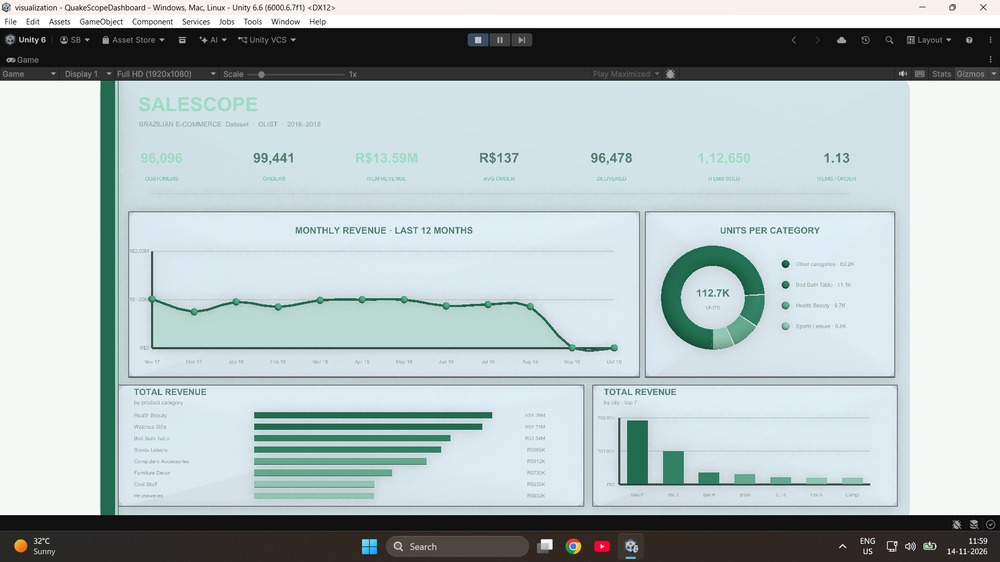

# Salescope

Salescope is an interactive 3D sales dashboard built in Unity. It turns the Olist Brazilian e-commerce dataset into live KPIs and 3D charts.

The dashboard includes a monthly revenue line chart, category donut, product revenue bars, city columns, and a ranked green palette. KPI values, chart shapes, and axes update from the CSV while the scene is running.

## Run it

Open the project in **Unity 6.6.7f1**, open `Assets/Scenes/SalescopeDashboard.unity`, and press **Play**. To update the dashboard, append rows to `LiveData/OlistSales.csv` in Excel and save as CSV UTF-8. Unity checks for updates every 1.5 seconds.

## Current dataset KPIs

  <table>
    <thead>
      <tr><th align="center">KPI</th><th align="center">Value</th></tr>
    </thead>
    <tbody>
      <tr><td align="center">Customers</td><td align="center">96,096</td></tr>
      <tr><td align="center">Orders</td><td align="center">99,441</td></tr>
      <tr><td align="center">Item revenue</td><td align="center">R$13.59M</td></tr>
      <tr><td align="center">Average revenue per order</td><td align="center">R$137</td></tr>
      <tr><td align="center">Delivered orders</td><td align="center">96,478</td></tr>
      <tr><td align="center">Units sold</td><td align="center">112,650</td></tr>
      <tr><td align="center">Units per order</td><td align="center">1.13</td></tr>
    </tbody>
  </table>

Data: [Brazilian E-Commerce Public Dataset by Olist](https://www.kaggle.com/datasets/olistbr/brazilian-ecommerce), 2016–2018. Revenue sums item prices and excludes freight; the dataset has no profit field. Source license: CC BY-NC-SA 4.0. Details: [Datasets/OlistSource.md](Datasets/OlistSource.md).
